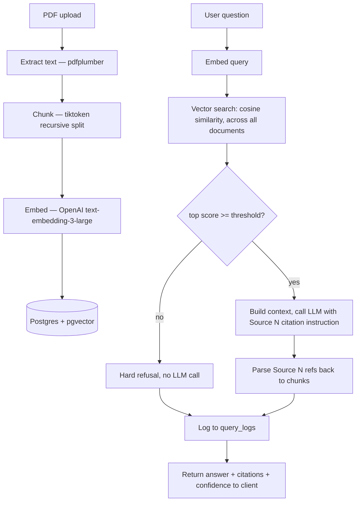

# RAG Architecture Log

Living reference for how this system actually works, kept in sync with the code.
Purpose: this project is for learning RAG at production depth, not just shipping
a demo — so each section explains the mechanism and the *why*, then calls out
what a naive/basic implementation is still missing versus the production-grade
version of that same piece. Update this file whenever `chunker.py`, `embedder.py`,
`vector_search.py`, or `chat_manager.py` change.

**Last synced with code:** 2026-10-21

---

## 1. End-to-end flow



---

## 2. Ingestion pipeline

### 2.1 Extraction — `backend/app/pipeline/extractor.py`

`PdfPlumberExtractor` (the default; `EXTRACTOR=docling` swaps in a heavier
alternative) walks each PDF page, pulls text with `page.extract_text()`, and
separately pulls tables with `page.extract_tables()`, converting each table to
a **markdown table string** appended after the page's prose text. This matters
because a naive `extract_text()`-only approach flattens tables into
whitespace-mangled garbage — a price table becomes unreadable noise. Markdown
tables survive chunking and the LLM can actually read them.

Output is `ExtractionResult(text, pages)` — the full concatenated text (for
chunking) plus a per-page list (for mapping chunks back to page numbers later).

**Why pdfplumber over Docling by default:** pdfplumber is lightweight and fast.
Docling does layout-aware, ML-based parsing (better at multi-column layouts,
nested tables, reading order) but is heavy to install/run. The extractor is
pluggable specifically so this tradeoff can be swapped per-deployment.

### 2.2 Chunking — `backend/app/pipeline/chunker.py`

**Strategy: recursive character/token splitting**, the same idea LangChain's
`RecursiveCharacterTextSplitter` uses, reimplemented directly:

1. Encode the full text with `tiktoken`'s `cl100k_base` encoding (same tokenizer
   Claude/GPT-family models roughly approximate — this keeps chunk sizes
   accurate to what the LLM actually sees as tokens, not just characters).
2. If a text block already fits in `max_tokens` (1500), keep it as one chunk.
3. Otherwise, try splitting on `["\n\n", "\n", ". ", " "]` **in that order** —
   paragraph breaks first, falling back to sentences, falling back to words.
   This is the core idea: prefer splitting at natural semantic boundaries over
   splitting mid-sentence, only degrading to a cruder boundary when a chunk
   still doesn't fit.
4. Whatever doesn't fit even after the coarsest split (words) gets a hard
   token-count split (`_token_split`) as a last resort — no boundary awareness
   at all, just cut at the token limit.
5. **Overlap** (`overlap_tokens=200`): each chunk after the first is prefixed
   with the last 200 tokens of the previous chunk. Why: without overlap, a
   sentence that answers a question can get sliced exactly at the chunk
   boundary, and neither half retrieves well on its own. Overlap gives every
   idea a decent chance of appearing whole in at least one chunk.
6. **Page number tracking**: `_build_page_map` records character-offset ranges
   per PDF page, then `_get_page_numbers` finds which page(s) a chunk's text
   falls inside — this is what makes "Page 4" show up in citations. Note this
   is done by locating the chunk's substring back in the original text
   (`text.find`), which is a bit fragile (see gaps below).
7. **Section header detection** (`_detect_section_header`): a regex heuristic
   (`^[A-Z][A-Za-z0-9 .:\-/&,()]{2,80}$`) checks the first 3 lines of a chunk
   for something that *looks* like a heading (capitalized, short, no trailing
   period-heavy prose). Best-effort only — it'll misfire on short capitalized
   sentences. No real document structure (actual heading levels, TOC) is used
   because pdfplumber doesn't expose that; Docling would.

### 2.3 Embedding — `backend/app/pipeline/embedder.py`

All chunks for a document are embedded in **one batched OpenAI API call**
(`self.client.embeddings.create(input=texts)`) rather than one call per chunk —
this is a real cost/latency win: far fewer round trips, and OpenAI's embeddings
endpoint is built for batch input.

**Model: `text-embedding-3-large`, truncated to 1536 dimensions** via the API's
native `dimensions` parameter (the model's native size is 3072; OpenAI supports
requesting a shorter, still-well-formed embedding via Matryoshka-style
truncation rather than you doing PCA yourself). 1536 was picked to halve
storage/index cost and speed up the ANN index (see below) at some recall cost
versus the full 3072 — a real tradeoff, not measured against the actual corpus
here yet.

Each chunk's embedding, text, page numbers, and metadata (JSON, containing
`section_header` if detected) get bulk-inserted into `chunks` via
`executemany`. The `documents` row is created first so `chunks.document_id`
has something to reference; `file_path` is now stored on it too, which is what
makes admin re-index possible (see §6) — pipeline is not fully idempotent
without the original file to re-extract from.

### 2.4 Storage — `init.sql`

```
chunks.embedding  vector(1536)
CREATE INDEX chunks_embedding_idx ON chunks
  USING ivfflat (embedding vector_cosine_ops) WITH (lists = 100);
```

**IVFFlat, not exact search.** pgvector supports brute-force exact
(`<->`/`<=>` with no index — O(n) but always exactly correct) or approximate
indexes (IVFFlat, or HNSW). IVFFlat clusters vectors into `lists` (100 here)
buckets at index-build time; a query only searches the nearest few buckets
instead of every row — much faster at scale, at the cost of *possibly missing*
a true nearest neighbor if it landed in a bucket the query didn't probe. At
this project's corpus size (dozens to low hundreds of chunks) the index barely
matters — exact search would be just as fast — but it's here because it's what
a real deployment needs and `lists = 100` is a reasonable default for a
small-to-medium corpus (rule of thumb: `lists ≈ rows / 1000` for larger
datasets; too many lists on a small table hurts recall for no speed benefit —
worth revisiting if the corpus grows).

`vector_cosine_ops` means the index is built for **cosine distance**
specifically — matches the `<=>` operator used in queries (§3). Postgres
won't use this index at all if you query with a different distance operator.

---

## 3. Retrieval — `backend/app/services/vector_search.py`

1. Embed the incoming query with the *same* model/dimensions as ingestion —
   this has to match exactly, since embeddings from different models (or
   different dimension truncations) aren't comparable.
2. Run `1 - (c.embedding <=> $1) AS score` — pgvector's `<=>` returns **cosine
   distance** (0 = identical direction, 2 = opposite), so `1 - distance` turns
   it into a similarity score in roughly `[-1, 1]`, matching the usual
   "closer to 1 is more similar" mental model.
3. Join `documents` in the same query to get `doc_title` for free — avoids a
   second round trip, and is what citations are built from.
4. Scoped by `document_id` when chatting inside one document (the whole app is
   currently single-document-scoped chat — there's no cross-document search
   used by the chat flow, even though the SQL supports an unscoped mode).
5. `min_score` is applied **after** the SQL query, in Python, not as a `WHERE`
   clause — meaning `top_k` rows always come back from Postgres and get
   filtered client-side. Fine at this scale; at a bigger corpus you'd want the
   floor pushed into SQL to avoid transferring rows you'll throw away.

This is **pure dense vector search — nothing else.** No keyword matching, no
reranking. See §7 for what that's missing.

---

## 4. Confidence & refusal — `backend/app/services/chat_manager.py`, `config.py`

```
similarity_threshold = 0.25   # below this: refuse, never call the LLM
confidence_medium    = 0.30
confidence_high      = 0.40
```

The **why** behind a hard refusal instead of just letting the LLM say "I don't
know": an LLM given weak/irrelevant context will still often *try* to answer,
hallucinating something plausible-sounding from its training data instead of
the document. Refusing before the LLM call is a structural guarantee against
that failure mode — no prompt engineering can make this airtight, but not
calling the model at all when retrieval already looks bad, can.

**These specific numbers are unvalidated guesses**, not measured — the
`config.py` comment says as much: `text-embedding-3-large` cosine scores tend
to run 0.2–0.5 for real (non-duplicate) query/document pairs, so the
thresholds were picked to sit inside that range, not derived from actually
scoring this corpus's expected-good vs. expected-bad retrievals. This is
exactly the gap the golden-set eval (§7, "retrieval evaluation") is meant to
close — right now there's no measurement backing these numbers at all.

---

## 5. Generation & citations — `chat_manager.py`

**Chat is global, not per-document** (changed 2026-10-21, see §10): `handle_message`
takes no `document_id` — `vector_search()` is called unscoped, searching every
ingested document, same as `/api/search`. Conversation history and `query_logs`
are scoped by `session_id` (browser cookie) instead. This matches how the
system is actually used now: one assistant over the whole corpus, not pick-a-
document-then-chat.

- **Context building** (`_build_context`): dedupes search results by exact
  chunk text (overlap can otherwise return literal duplicate chunk content
  from two different chunk rows), then labels each with
  `[Source N | "doc title" | Page X | Section: ...]` before the chunk text.
- **System prompt** explicitly instructs the model to cite with `[Source N]`
  inline — this is prompt-level citation, not a structural guarantee; the
  model can simply not comply, which is why citation extraction has a fallback
  (below).
- **Conversation history**: last 10 messages from `messages` (not `query_logs`)
  are replayed as real user/assistant turns to the LLM, not flattened into a
  single string — lets the model use native multi-turn context.
- **Citation extraction** (`_extract_citations`): regex-matches `[Source N]`
  in the model's raw output, maps each N back to the same deduped/ordered
  result list used to build the prompt. If the model cited nothing explicitly,
  **all** sources used in the context are returned as citations instead of
  none — an intentional fallback so the UI doesn't show zero citations just
  because the model forgot the instruction.
- The raw `[Source N]` markers are stripped from the text shown to the user
  client-side (`stripSourceRefs` in `ChatMessage.tsx`) — the citation chips
  are the UI's actual citation display, the inline markers are just the
  mechanism to extract them.

---

## 6. Logging & admin — `query_logs` table, `backend/app/api/routes/admin.py`

`query_logs` is a **separate table from `messages`**, written on every chat
call (refused or not) — see §7 for the full reasoning on why two tables exist.
Short version: `messages` is "what a conversation thread looks like",
`query_logs` is "one flat analytics row per question", built specifically to
be aggregated for eval metrics and browsed in the admin Query Log tab without
joining through the conversational structure.

The admin panel (`/admin`) also supports **re-indexing a document** — deletes
its `chunks` rows and re-runs extract → chunk → embed from the stored
`file_path`. This is why `documents.file_path` was added: without the original
file on disk, there's nothing to re-extract from, and re-index 410s.
`reindex-all` does the same for every document, in the background.

---

## 7. Basics vs. production depth

This is the map of what exists today (the "basics": embed, store, retrieve,
stuff into a prompt) against what production-grade RAG requires — the part
interviewers actually probe, and the reason this file exists.

| Topic | What's here today | What's missing / the deeper version |
|---|---|---|
| **Chunking strategy** | One fixed strategy: recursive token split, 1500/200, applied identically to every document regardless of structure. | No comparison against alternatives: semantic chunking (split on embedding-similarity breakpoints between sentences, not just fixed size), structure-aware chunking (real headings/sections from a layout parser like Docling, not the regex heading guess), or chunk-size tuning validated against retrieval quality rather than picked by intuition. Table rows currently get chunked like prose — no special handling to keep a table intact as one retrievable unit. |
| **Search: dense-only vs. hybrid** | Pure cosine similarity over dense embeddings. Nothing else. | No keyword/lexical search (BM25 / Postgres full-text `tsvector`) running alongside vector search. Dense embeddings are weak at exact terms — SKU codes, exact policy numbers, acronyms, proper nouns the embedding model wasn't trained to distinguish well. Hybrid search runs both and fuses results (commonly with Reciprocal Rank Fusion), catching cases dense-only retrieval misses. |
| **Reranking** | None. Whatever the top-`k` vector search returns is what goes straight into the prompt. | No cross-encoder reranking step (e.g. a `bge-reranker` or Cohere rerank call) between "get top 20 cheap-but-approximate candidates" and "pick the best 5 for the prompt." Bi-encoder similarity (what embeddings give you) and true relevance often disagree; a reranker scores query+candidate jointly and is much more accurate, but too slow to run over the whole corpus — hence retrieve-then-rerank as a two-stage pipeline. |
| **Retrieval evaluation vs. answer evaluation** | No evaluation of any kind is implemented yet (`admin/eval` is a placeholder). The `eval_runs`/`eval_results` tables and `knowledge_base_refactor.md` spec describe faithfulness/relevance (answer-quality) scoring via LLM-as-judge. | Retrieval quality and answer quality are two different failure modes that need two different metrics — a system can retrieve perfectly and still generate a bad answer, or retrieve garbage and still generate a plausible-sounding (wrong) answer. Retrieval needs its own measurement, independent of whether the final answer was good: precision@k / recall@k / MRR against a labeled golden set (does the *right chunk* show up in the top-k, not just "did the answer sound right"). This project's planned golden-set runner (Phase 4) is exactly that — it doesn't exist in code yet. |
| **Stale documents** | Manual re-index only, triggered by a human clicking a button in `/admin`. No detection of whether a source document changed. | No mechanism to detect a document changed since last indexed (no content hash / `updated_at` diffing), no partial re-embedding (a one-line edit to a 50-page doc re-embeds and re-chunks the whole thing), no versioning of chunks (old chunks aren't invalidated atomically with new ones — a race between delete-old and insert-new could serve an inconsistent index mid-reindex). |
| **Diagnosing bad recall** | No tooling at all — if the wrong chunk gets retrieved, there's no way to tell *why* short of reading the SQL results by hand. | No systematic way to separate the possible causes: bad chunking (the right answer was split away from its identifying context), bad embedding (the model doesn't represent this query/document pair's semantic similarity well — happens a lot with domain jargon), bad query (the user's phrasing is semantically far from how the document states it — query rewriting/expansion would help), or bad index (an ANN index approximation miss, unlikely to matter at this corpus size but real at scale). This is exactly what retrieval-specific eval (previous row) is for — without it, "why is recall bad" has no answer. |

---

## 8. Open questions to come back to

- Is 1536-dim truncation actually costing meaningful recall vs. the native
  3072-dim embedding, on *this* corpus? Would need A/B retrieval eval to know.
- Are the confidence/refusal thresholds (0.25/0.30/0.40) right, or an
  accidental over/under-refusal rate? Needs the golden set + real usage data.
- Page-number-to-chunk mapping via `text.find()` in `chunker.py` assumes the
  chunk's text appears verbatim in the original extracted text — true today,
  but worth re-checking if extraction logic (e.g. table markdown injection)
  ever changes where a chunk's text diverges from the source page text.

---

## 9. Eval dataset decision (2026-10-19, revised same day)

No real documents exist yet to build the golden set that `knowledge_base_refactor.md`
Phase 4 calls for (originally planned as a hand-written `golden_set.json` over a
fictional Acme Corp SOP corpus).

**First pick, superseded: RagQuAS** (Spanish, human-verified Q&A). Dropped
because it ships raw text, not PDFs — would've needed a text-to-PDF conversion
step, and its source pages have no tables, so it never exercises the
project's table-extraction code path (`extract_tables()` → markdown, §2.1).

**Final pick: FinanceBench (open version)** —
[patronus-ai/financebench](https://github.com/patronus-ai/financebench). Ships
real PDFs (US company financial reports, which naturally contain tables), and
each question already has a gold answer, the evidence text, **and the page
number** — a direct test of the page-citation feature in `chunker.py`/
`chat_manager.py`, with zero conversion work needed. Trade-off: English only
(chose pipeline fidelity over matching a Spanish target corpus), and CC BY-NC
4.0 — same non-commercial conflict already flagged for the public-demo plan.

150 questions, one expected doc + page per question (simpler golden-set
schema than RagQuAS's list-of-docs). **SQAC** stays earmarked separately for
[[chunking-strategy-experiment-plan]] — unaffected by this switch, since that
experiment only needs retrieval-only volume, not gold answers.

**Ingestion steps:** download the repo's PDFs + question/answer/evidence/page
CSV directly — no conversion step. Build `eval/golden_set.json` straight from
that CSV (doc filename + page number + gold answer per question), then ingest
the PDFs through the existing `/api/document/upload` flow.

**Retrieval-precision runner built** (`eval/run_retrieval_eval.py`, 2026-10-21):
calls the existing unscoped `/api/search` endpoint per golden question, checks
whether the top-1 result's document matches, writes into the (previously
empty) `eval_runs`/`eval_results` tables already in `init.sql`. First run on
the 10-doc/20-question subset: **16/20 = 80% retrieval precision**.

All 4 misses had `was_refused = false` — meaning the system would have
confidently answered from the *wrong* document rather than refusing. The
0.25 `similarity_threshold` (§4) catches *weak* matches, not *wrong-but-
confident* ones; a real document can score 0.40-0.64 while still being the
wrong source. This is exactly the gap §4's "unvalidated guesses" note was
flagging, now backed by real data instead of a hunch.

---

## 10. Global chat redesign + generation eval (2026-10-21)

**Why:** building the generation eval exposed that `/api/chat/chat` required a
`documentId` — there was no way to test "does the system find the right doc
AND answer well" in one pass, only "given the doc is already known, does it
answer well." Decided to fix this at the product level: chat is now global
(searches every document, like a real enterprise RAG assistant) instead of
picking one document first via a `share_token` link. See §5 for the resulting
`chat_manager.py` scoping change. `share_token` is removed entirely (confirmed
it had no other use anywhere in the codebase); `documents.share_token`,
`client/chat/[token]/page.tsx`, and the per-document chat UI are gone.
Conversation history moved from `messages.document_id` to a new
`messages.session_id` column, scoped per browser session.

**Three latent LLM-provider bugs surfaced** once a real chat call finally ran
(the retrieval-only eval never exercised generation at all):
1. `config.py`'s default model, `claude-sonnet-4-20250514`, was retired by
   Anthropic (`404 not_found_error`). Fixed by checking
   `client.models.list()` against the actual API key rather than guessing a
   replacement — now `claude-sonnet-5-5`.
2. Current Claude models reject the `temperature` param entirely
   (`400 temperature is deprecated for this model`) — dropped it from the
   Anthropic request in `anthropic_provider.py`.
3. `response.content[0].text` assumed the first content block was always
   text; current models can prepend a `ThinkingBlock` (extended thinking)
   first, which has no `.text` — fixed to scan for the actual text block.

**Generation eval built** (`eval/run_generation_eval.py`): per golden
question, calls `/api/search` (for judge context) and the real
`/api/chat/chat` (full retrieval + generation), then one combined LLM-judge
call scoring **faithfulness** (is the answer grounded in retrieved context?)
and **correctness** (does it match the gold answer?) separately — an answer
can be faithful but wrong, or correct without actually using the context.
Added `eval_results.correctness_score` (no column existed for this).
Always writes a fresh `eval_runs` row (never updates the retrieval-only
`eval_run 1`).

**First full run** (`eval_run 2`): 80% retrieval precision (unchanged from
the retrieval-only run — same corpus), **94% faithfulness**, **87%
relevance**, but only **76% correctness**, and **0% refusal rate** across
all 20 questions. The faithfulness/correctness gap is the interesting part:
the model is often faithfully summarizing the retrieved context while still
landing on a wrong final answer — e.g. reading the wrong number out of a
messy table, or missing a step in a multi-part calculation. That is a
different failure mode than hallucination, and faithfulness alone would
never catch it.

**Eval dashboard wired up** (`GET /api/admin/eval/latest`, `/history`,
`client/app/admin/eval/page.tsx`): read-only per decision — displays whatever
the latest script run wrote, no in-browser "run it" trigger yet (would need
the eval logic running inside the backend process, not a CLI script).
